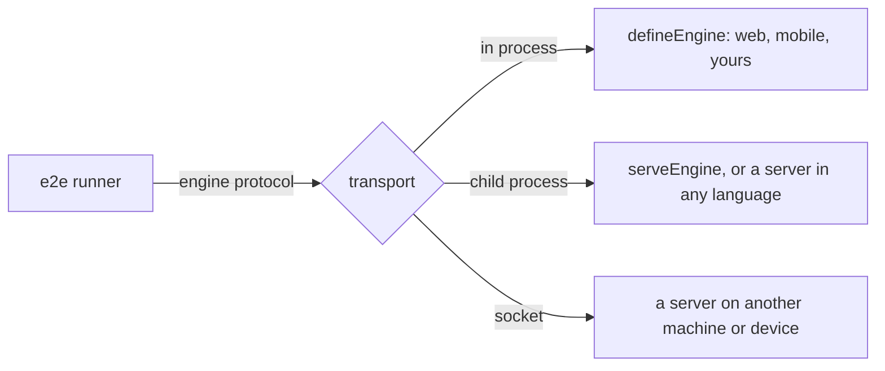

An engine drives a user interface, such as a browser, a simulator, or a TV,
for `screen`, `app`, and the agent. `@e2e-dev/web`, `@e2e-dev/mobile`,
`@e2e-dev/desktop`, and `@e2e-dev/electron` are engines, and you can write
one for another platform. The runner drives every engine over the
[engine protocol](/reference/engine-protocol): JSON-RPC messages, one per
engine member.

## Choose how to write one

| You want | Write | Start at |
| --- | --- | --- |
| An engine in TypeScript | `defineEngine`, set on a target | [Writing an engine](/writing-an-engine) |
| A TypeScript engine in its own process | `defineEngine`, served with `serveEngine` | [Serve a TypeScript engine](/reference/engine-protocol#serve-a-typescript-engine) |
| An engine in another language, or on a device | A server that answers the protocol's messages | [Write a server in another language](/reference/engine-protocol#write-a-server-in-another-language) |

An engine from `defineEngine` runs in the runner's process. Every call still
crosses the protocol, so an engine that passes its suite needs nothing a
server elsewhere couldn't receive.

## Find a type or a message

Every path implements one contract, and two pages hold all of it:

| You need | Page |
| --- | --- |
| A member, hook, capability, type, or error code of the contract | [`e2e/engine`](/reference/engine) |
| A message's params and result, a transport, or `connectEngine` and `serveEngine` | [Engine protocol](/reference/engine-protocol) |

## Learn from the Electron engine

[`@e2e-dev/electron`](/electron) is the model for an engine built outside
this repository. It imports only `@e2e-dev/core/engine`, and speaks the
DevTools protocol itself: no automation library and nothing from another
engine. Building it showed
where the contract assumed a browser or a device:

| Assumption | What changed |
| --- | --- |
| A selector is answered synchronously in `resolveExpression` | Core exports `expressionSelectors`, so an engine queries every selector first, over any protocol |
| An app without a URL is a device app | `app.open()` calls `session.restart`, a fresh launch. Without `session.open`, an engine needs no navigation and no browser context per attempt |
| A surface has tabs | Windows fit `EngineSnapshot.tabs`, `switchTab`, and `closeTab` |
| The engine decides headed or headless | Electron has neither. The app decides, and the engine ignores `--headed` |
| A `file:` page belongs to a file app | Not fixed. The file-app bound keys on `app.url`, so the `file:` pages an Electron app loads on its own are outside it |

## Next

<CardGroup cols={2}>
  <Card title="Writing an engine" icon="code" href="/writing-an-engine">
    Build an engine with `defineEngine`, step by step.
  </Card>
  <Card title="Engine servers" icon="network-wired" href="/reference/engine-protocol#engine-servers">
    Run an engine in another process, machine, or language.
  </Card>
</CardGroup>
