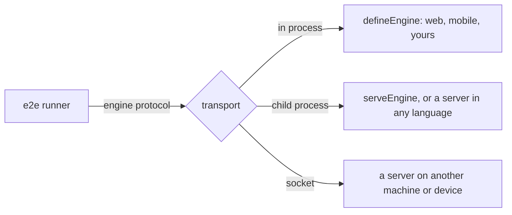

Uma engine controla uma interface de usuário, como um navegador, um simulador
ou uma TV, para `screen`, `app` e o agente. O runner controla toda engine pelo
[protocolo de engine](/reference/engine-protocol): mensagens JSON-RPC, uma por
membro da engine. `@e2e-dev/web`, `@e2e-dev/mobile`, `@e2e-dev/desktop` e
`@e2e-dev/electron` também são engines.

## Escolha como escrever uma

| Você quer | Escreva | Guia |
| --- | --- | --- |
| Uma engine em TypeScript | `defineEngine`, definida em um alvo | [Escrevendo uma engine](/writing-an-engine) |
| Uma engine TypeScript em um processo próprio | `defineEngine`, servida com `serveEngine` | [Servidores de engine](/engine-servers#serve-a-typescript-engine) |
| Uma engine em outra linguagem, ou em um dispositivo | Um servidor que responde às mensagens do protocolo | [Servidores de engine](/engine-servers#write-a-server-in-another-language) |

Uma engine criada com `defineEngine` roda no processo do runner. Mesmo assim,
toda chamada atravessa o protocolo, então uma engine que passa na própria
suíte de testes não precisa de nada que um servidor em outro lugar não poderia
receber.

## Aprenda com a engine Electron

[`@e2e-dev/electron`](/electron) é o modelo a seguir para uma engine construída
fora deste repositório. Ela importa só `@e2e-dev/core/engine` e fala o protocolo
DevTools por conta própria: nenhuma biblioteca de automação e nada de outra
engine. Construí-la mostrou
onde o contrato supunha um navegador ou um dispositivo:

| Suposição | O que mudou |
| --- | --- |
| Um seletor é respondido de forma síncrona em `resolveExpression` | O core exporta `expressionSelectors`, então uma engine consulta todos os seletores primeiro, por qualquer protocolo |
| Um app sem URL é um app de dispositivo | `app.open()` chama `session.restart`, uma nova inicialização. Sem `session.open`, uma engine não precisa de navegação nem de um contexto de navegador por tentativa |
| Uma superfície tem abas | As janelas se encaixam em `EngineSnapshot.tabs`, `switchTab` e `closeTab` |
| A engine decide entre headed e headless | O Electron não tem nenhum dos dois. O app decide, e a engine ignora `--headed` |
| Uma página `file:` pertence a um app de arquivo | Não foi corrigido. O limite de app de arquivo depende de `app.url`, então as páginas `file:` que um app Electron carrega por conta própria ficam fora desse limite |

## Próximos passos

<CardGroup cols={2}>
  <Card title="Escrevendo uma engine" icon="code" href="/writing-an-engine">
    Construa uma engine com `defineEngine`, passo a passo.
  </Card>
  <Card title="Servidores de engine" icon="network-wired" href="/engine-servers">
    Rode uma engine em outro processo, outra máquina ou outra linguagem.
  </Card>
  <Card title="e2e/engine" icon="book" href="/reference/engine">
    Cada tipo e cada hook do contrato de engine.
  </Card>
  <Card title="Protocolo de engine" icon="book" href="/reference/engine-protocol">
    Cada mensagem, do jeito que um servidor a recebe.
  </Card>
</CardGroup>
